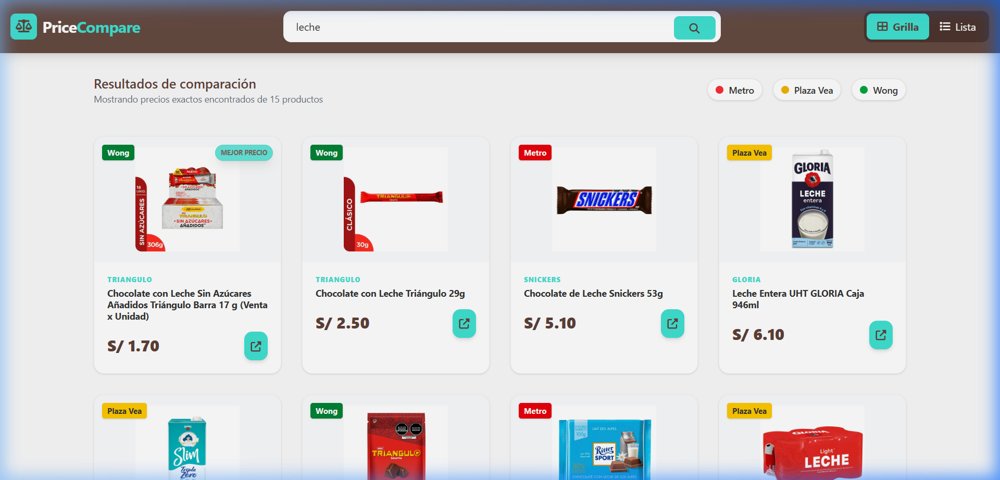

# ⚖️ PriceCompare

**Real-time supermarket price comparison engine for Peru's largest retailers.**

> 🌐 [Versión en Español](README.es.md)

[](https://react.dev/)
[](https://www.typescriptlang.org/)
[](https://tailwindcss.com/)
[](https://fastapi.tiangolo.com/)
[](https://www.python.org/)
[](https://vite.dev/)
[](LICENSE)

---



---

## ✨ Features & Engineering Highlights

- **Parallel Scraping via Reverse Engineering** — Data is extracted from **Metro**, **Wong**, and **Plaza Vea** private VTEX APIs simultaneously using `asyncio.gather`, with no browser automation overhead.
- **Polymorphic Scraper Registry** — A `BaseScraper` abstract class with a `SCRAPERS_REGISTRY` list. Adding a new store is a single class definition — zero routing changes required.
- **In-Memory TTL Cache** — Search results are cached for 1 hour using `cachetools.TTLCache` (200 entries max), dramatically reducing redundant API calls to external sources.
- **SQLite Price History Tracking** — Every scraped price is persisted with timestamps via UPSERT logic, enabling future price trend analysis per SKU.
- **AbortController Integration** — Stale HTTP requests are cancelled automatically when a new search is triggered, preventing race conditions and false error states.
- **Debounced Search (500ms)** — A generic `useDebounce` hook delays API calls while the user types, reducing server load without sacrificing perceived responsiveness.
- **URL-Synced State** — Search queries and active store filters are serialized into URL search params (`?q=leche&tiendas=Metro,Wong`), enabling **shareable search links**.
- **Computed Best Price Badge** — The lowest price across all filtered results is dynamically calculated and rendered as a visual badge — not stored in the data model.
- **Cross-Component Filter Context** — A `FilterContext` with React Context API shares store filter state globally without prop-drilling.
- **Grid / List Toggle** — Users can switch between card grid and compact list layouts in a single click.

---

## 🛠️ Tech Stack

| Layer | Technology | Purpose |
|---|---|---|
| **Frontend** | React 19, TypeScript 5.2 | Component-based SPA |
| **Styling** | Tailwind CSS 4.2 | Utility-first responsive design |
| **Bundler** | Vite 8 | HMR dev server and production builds |
| **Routing** | React Router DOM 7 | URL search param synchronization |
| **Backend** | FastAPI, Python 3.12 | Async REST API (`/api/v1/`) |
| **HTTP Client** | httpx | Async requests to external VTEX APIs |
| **Database** | SQLite | Price history persistence |
| **Cache** | cachetools (TTLCache) | 1h in-memory search result caching |
| **Validation** | Pydantic 2 | Request/response schema validation |
| **Frontend Hosting** | Vercel | Auto-deployed from `main` branch |
| **Backend Hosting** | Render | FastAPI server with auto-sleep |

---

## 🚀 Getting Started

### Prerequisites

- **Node.js** ≥ 18 and **pnpm**
- **Python** ≥ 3.10

### 1. Clone the repository

```bash
git clone https://github.com/Doki2007/Price-Comparator.git
cd Price-Comparator
```

### 2. Backend setup

```bash
cd backend
python -m venv .venv

# Windows
.venv\Scripts\activate
# macOS / Linux
source .venv/bin/activate

pip install -r requirements.txt
python main.py
```

The API will be available at `http://localhost:8000`. Interactive docs at `http://localhost:8000/docs`.

### 3. Frontend setup

```bash
cd frontend
pnpm install
pnpm run dev
```

The app will be available at `http://localhost:5173`.

> [!NOTE]
> By default, the frontend points to the production API on Render. To use your local backend, update the fetch URL in [`frontend/src/hooks/useFetchApi.ts`](frontend/src/hooks/useFetchApi.ts) to `http://localhost:8000/api/v1/search`.

---

## 📁 Project Structure

```
compare-prices/
├── backend/
│   ├── api/
│   │   └── router.py          # FastAPI route handlers (search, price history)
│   ├── database.py             # SQLite init, UPSERT logic, history queries
│   ├── main.py                 # FastAPI app entry point + CORS config
│   ├── schemas.py              # Pydantic models (ProductOut, SearchResponse)
│   ├── scrapers.py             # BaseScraper → VtexScraper → Metro/Wong/PlazaVea
│   └── requirements.txt
├── frontend/
│   ├── src/
│   │   ├── components/
│   │   │   ├── layout/         # Header, Footer, Skeleton
│   │   │   └── products/       # ProductCard (grid/list variants)
│   │   ├── contexts/
│   │   │   └── FilterContext.tsx  # Global store filter state
│   │   ├── hooks/
│   │   │   ├── useFetchApi.ts    # API fetcher with AbortController
│   │   │   └── useDebounce.ts    # Generic debounce utility
│   │   ├── types/
│   │   │   └── types.ts          # Product, Store, FilterContextType
│   │   ├── App.tsx               # Main orchestrator (filters, URL sync, search)
│   │   └── main.tsx              # React root with providers
│   ├── package.json
│   └── vite.config.ts
├── AGENTS.md                     # AI agent guidelines
├── LICENSE
└── README.md
```

---

## 🗺️ Roadmap

- [x] VTEX scraper engine for Metro, Wong, and Plaza Vea
- [x] FastAPI backend with async parallel scraping
- [x] In-memory TTL cache to reduce external API calls
- [x] SQLite persistence with price history per SKU
- [x] React frontend with grid/list product cards
- [x] Debounced search with AbortController
- [x] Store filter pills with React Context
- [x] URL search param synchronization (shareable links)
- [x] Dynamic "Best Price" badge calculation
- [x] Vercel + Render deployment
- [ ] Price history charts per product (line graph over time)
- [ ] GSAP scroll animations and premium micro-interactions
- [ ] Dark mode toggle
- [ ] Add more stores (Tottus, Vivanda)
- [ ] User-Agent rotation and anti-ban header strategies
- [ ] Sorting options (price asc/desc, store, relevance)
- [ ] Mobile-optimized responsive design refinements
- [ ] PostgreSQL migration for production persistence

---

## 📄 License

This project is licensed under the [MIT License](LICENSE).

**© 2026 Jamir Garro**
